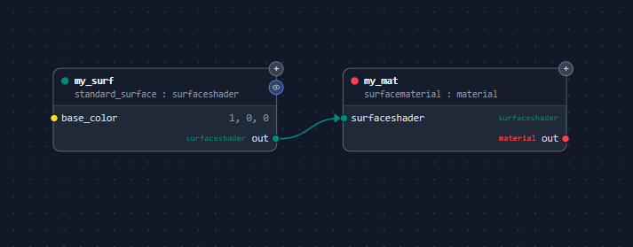
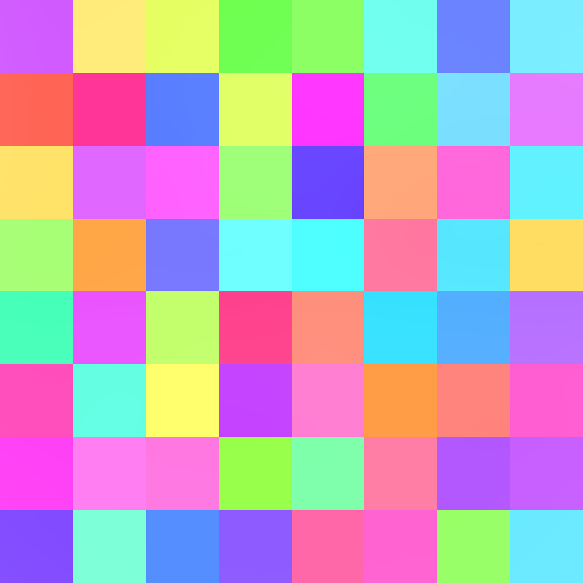
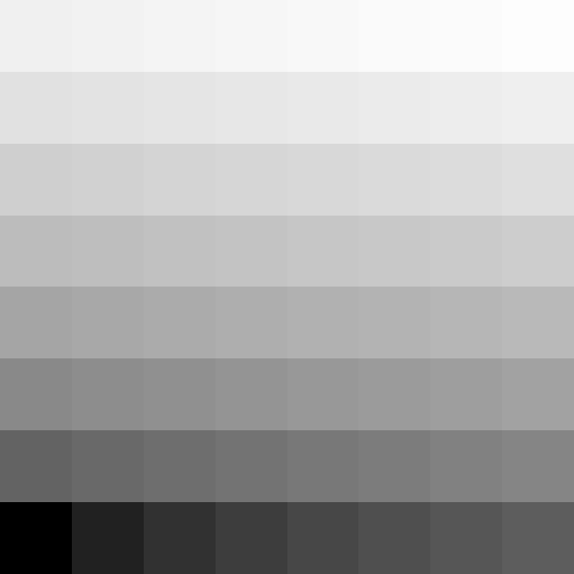

# Hello, ShadingLanguageX!

This document is meant to serve as a first introduction to ShadingLanguageX (SLX), its main purpose, how to use it, and the
syntax of the language.

## What is ShadingLanguageX?

SLX is a programming language that compiles to MaterialX `.mtlx` files. Its primary goal to make it easier for artists and developers
to create complex MaterialX shaders, although it's perfectly well suited to create simple shaders as well.

I created it after trying to write a MaterialX [interior mapping](https://www.proun-game.com/Oogst3D/CODING/InteriorMapping/InteriorMapping.pdf) 
shader, first with a node graph editor, and then with the MaterialX Python API. The issue with complex algorithms is that
readability is key. The more concise, but obvious you can express something, the easier to becomes to work on it, improve it, and share it with others.
Neither graph editors nor the MaterialX Python API are very good in this regard, so it drove me to create something new, enter SLX.

## Your First SLX Shader

Okay, let's develop our first shader using SLX. We'll create something very basic to start with and work our way up.

### Setup

Before we start, I assume you already have a way to render `.mtlx` files. If not, you can use [MaterialXPlayground](https://joaovbs96.github.io/MaterialXPlayground/),
which not only renders `.mtlx`, but has built-in support for SLX, so can you follow this tutorial entirely in your browser.

Otherwise, to write and compile your SLX code, I recommend using the [VS Code extension](https://github.com/jakethorn/ShadingLanguageX/tree/main/tools/vscode_extension), which comes with many useful features
for writing SLX code. If you don't have VS Code, or don't want to install another extension, you can also use the 
[SLX to MTLX Converter](https://jakethorn.github.io/ShadingLanguageX/) directly from this repo.

If you are using Houdini, you can also use the [SLX Houdini plugin](https://github.com/jakethorn/ShadingLanguageX/tree/main/tools/houdini) which allows you to drop an SLX Material node
right into your Solaris scene.

Finally, for the more tech-savvy users, you can install the compiler locally using PyPI and run it with a short Python script.

```bash
pip install mxslcxx
```

```python
import mxslc

slx_path = "path/to/my/slx/file.mxsl"
mtlx_path = mxslc.compile_file_to_file(slx_path)
```

### The Code

Whatever setup you chose, let's get coding.

Let's start with the simplest shader possible...

```
surfaceshader my_surf = standard_surface(base_color = color3{1, 0, 0});
material my_mat = surfacematerial(my_surf);
```




Looking at the node graph, we can see that two nodes were created, a `standard_surface` node and a `surfacematerial` node,
with the names `my_surf` and `my_mat`.

***Note: I also assume that you have used MaterialX before and are familiar with its nodes and other features.
Just in case, here is a [link](https://github.com/AcademySoftwareFoundation/MaterialX/tree/main/documents/Specification) to the MaterialX specification.***

Obviously, each node was created by its corresponding function in SLX. SLX comes with a standard library of functions built
from the MaterialX node specification. The names of these functions all match their corresponding node and their parameters
match the nodes input names, types and order.

The reason we had to type `standard_surface(base_color = color3{1, 0, 0})`, instead of just `standard_surface(color3{1, 0, 0})`,
is because `base_color` is the second input on the node, the first being `base`. Alternatively, we could have written `standard_surface(1, color3{1, 0, 0})`
to set `base` to `1` and then passed the second argument to `base_color`.

This line also shows us how to define color3 variables: `color3{...}`. This expression uses the constructor syntax, i.e., 
it uses `{ }` as opposed to `( )` which functions use. There are many ways to construct a color3 variable:

```
color3{1, 0, 0}       // red
color3{1}             // equivalent to color3{1, 1, 1}
color3{0, 0.5, 1}     // blue
color3{normal()}      // convert from normal vector3
color3{texcoord(), 0} // convert from texcoord vector2, with b=0
```

Other color, vector and matrix types all have similar constructors.

### Next Steps

Let's make our shader a bit more complex...

```
float scale = 8;
float u, v = texcoord() * scale;
float seed = floor(u) + floor(v) * scale;
color3 c = randomcolor(seed);
surfaceshader s = standard_surface(base_color = c);
material m = surfacematerial(s);
```



This shader creates an 8x8 grid of colored squares. It does this by scaling the uv vector and then flooring the result.
By scaling the `v` component by the same amount as the uv vector and then adding them together, we can create a unique seed
for each square in the rendered image. For example, the bottom row of squares have seeds ranging from 0 to 7, the next row up
would range from 8 to 15, and so on:



This seed is passed to the standard library function `randomcolor`, which is subsequently passed to the `standard_surface`
and finally `surfacematerial` nodes.

There are three new things introduced here. The first is the introduction of a few more standard library functions: 
`texcoord`, `floor`, and `randomcolor`. The second is that SLX supports basic arithmatic
operators, e.g., `*` and `+`. It also supports `-` (both unary and binary), `/`, `%` (modulo), and `^` (power).

The last one is a bit more subtle. In the line `float u, v = texcoord() * scale;`, the expression `texcoord() * scale;`, is
actually returning a variable of type `vector2` (a `vector2` multiplied by a `float` is a `vector2`). However, it's being 
assigned to two `float`s. This is firstly because SLX allows multiple variables to be defined at once, and because SLX
can implicitly convert between a `vector2` and a tuple of two floats which are then bound to the variables `u` and `v`.
You can think of it as a shorthand of:

```
vector2 uv = texcoord() * scale;
float u = uv.x;
float v = uv.y;
```

One last thing to mention before we move on is that SLX has a fairly comprehensive function resolution engine. Looking back
again at the line `float u, v = texcoord() * scale;`, it's clear that we want to call the `texcoord` function that returns a 
`vector2` and not the one that returns a `vector3`, which also exists in MaterialX. The compiler knows this and picks the
correct function for us. It can do this because return types are part of a functions signature in SLX (unlike most other languages),
and the compiler informs the function call of the type it is expected to evaluate to (in this case a `vector2`).

### Let's Continue

This is the final version of the shader we will write today...

```
const float scale = 8;
const float frequency = 8;
const float amplitude = 1/8;
const int n = 1;

mutable vec2 uv = texcoord() * scale;
for (int i from 1 to n)
{
    uv += sin(uv.yx * frequency) * amplitude;
}

float seed = floor(uv.x) + floor(uv.y) * scale;
color3 c = randomcolor(seed);

surfaceshader s = standard_surface(base_color = c);
material m = surfacematerial(s);
```


Now we are iteratively applying the `sin` function to the uv coordinates before creating the seed, giving the pattern
its wavy appearance.

Feel free to play around with the constants at the top. Even with such a simple shader, you can make some incredible cool
designs, my particular favourite is this one:

```
const float scale = 2.77;
const float frequency = 2.77;
const float amplitude = 1;
const int n = 2;
```


Now, let's talk about the code!

As you can see, SLX supports multiple keywords related to behaviour of variables, notably in this code we are using the 
`const` and `mutable` modifiers. By default, variables in SLX are `const` anyway, so the `const` in this code is mostly for clarity,
however the `mutable` is necessary because `uv` changes during the lifetime of the shader. Removing the `mutable` modifier would
result in a compile error. There are other variable modifiers, such as `comptime`, `global`, and `geomprop` which we won't go
into now, but you can read about them in the [language specification](https://github.com/jakethorn/ShadingLanguageX/blob/main/docs/LanguageSpecification.md).

This shader also shows off the SLX for loop which iterates over a sequence of values. In our case, we are iterating from `1 to n`,
inclusive of `n`. So `1 to 2` would iterate twice, where `i` is `1` on the first iteration and `2` on the second.

There are several other ways to create and iterate over sequences in SLX, for example:

```
for (string space in {"model", object", "world"})
{
    ...
}

// f is 0 -> 2.5 -> 5 -> 7.5 -> 10
for (float f in 0 : 2.5 : 10)
{
    ...
}

// sequence can be stored as a variable
auto seq = 0 to 99;
for (int i from seq)
{
    ...
}
```

Finally, some smaller points. Like many other shading languages, SLX supports swizzles, we use one in the last shader to 
swap the u and v channels between each iteration `uv.yx`. I also used a compound assignment operator `+=` which is shorthand
for `x = x + y;`.

### Final Version

I'm not going to add any new features to our shader, but I'll tidy it up by wrapping up the pattern algorithm in a function...

```
[[inline]]
material create_material(float scale, float frequency, float amplitude, int n)
{
    mutable vec2 uv = texcoord() * scale;
    for (int i from 1 to n)
    {
        uv += sin(uv.yx * frequency) * amplitude;
    }

    float seed = floor(uv.x) + floor(uv.y) * scale;
    color3 c = randomcolor(seed);
        
    surfaceshader s = standard_surface(base_color = c);
    return surfacematerial(s);
}

material mat1 = create_material(2.77, 2.77, 1, 2);
material mat2 = create_material(4.41, 4.41, 1, 5);
```

Here, I am creating an `inline` function that encapsulates the logic of my shader. I can them call it multiple times with
different inputs to create many different variations of my pattern.

There are four types of functions in SLX: `inline`, `comptime`, `nodedef`, and `nodegraph`. They operate as follows:
`nodedef` functions compile to NodeDef/NodeGraph elements, e.g., a function called `foo` would compile to a NodeDef called
`ND_foo` and an associated NodeGraph called `NG_foo`. `nodegraph` functions skip the NodeDef element, and compile to only a
NodeGraph element. `inline` functions, like the one above, are flattened into the graph, producing only the nodes that make up
the function body, and `comptime` functions act exactly as `inline` functions do, but additionally try to compute as much as they can
during compilation. For example, the compiler is capable of taking the expression `1 + 1` and evaluating it to `2` without 
needing to create an `add` node in the graph. No all expressions can be performed at compile time however, `position()` for example
is obviously not available until render time.

## Wrap Up

That's all for this introduction to SLX! There are many more examples that can be found in the repository, [here](https://github.com/jakethorn/ShadingLanguageX/tree/main/examples) and [here](https://github.com/jakethorn/ShadingLanguageX/blob/main/docs/BasicExamples.md).
As well as the [user guide](https://github.com/jakethorn/ShadingLanguageX/blob/main/docs/UserGuide.md) and [language specification](https://github.com/jakethorn/ShadingLanguageX/blob/main/docs/LanguageSpecification.md). Also, check out the main [README.md](https://github.com/jakethorn/ShadingLanguageX/blob/main/README.md) to see where SLX is supported in other software
and open-source projects.

If you use SLX and find it useful please reach out and let me know, I'd love to hear about it! Or if you find a bug or
would like to see some new feature!

I'll leave you with one last render from this example project. I've tweaked the code slightly without showing it, see if you
can recreate it yourself!


## Acknowledgements

All images in this tutorial were rendered using [MaterialXPlayground](https://joaovbs96.github.io/MaterialXPlayground/).
