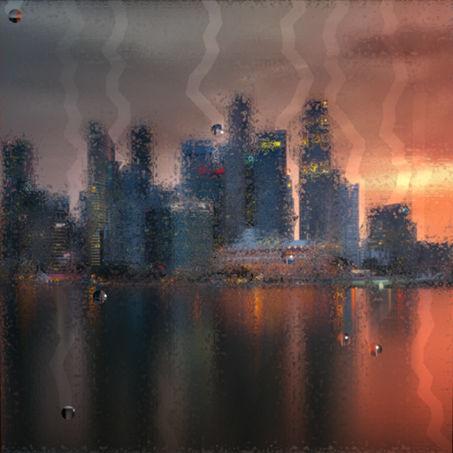
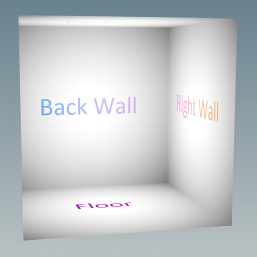
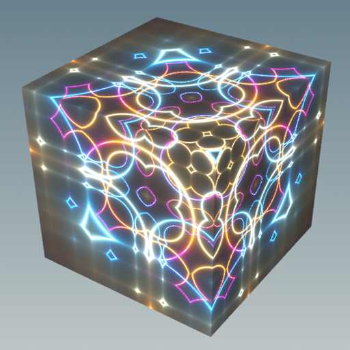
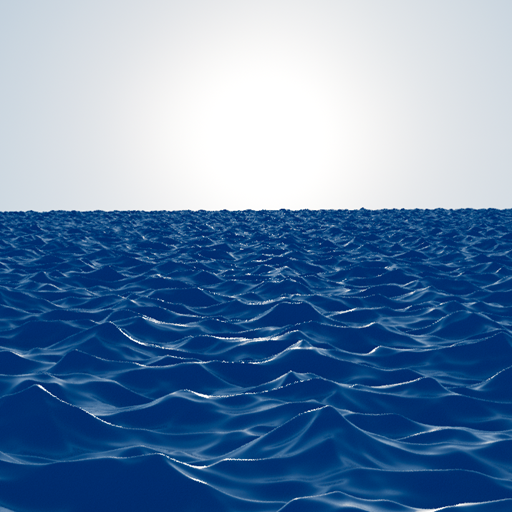
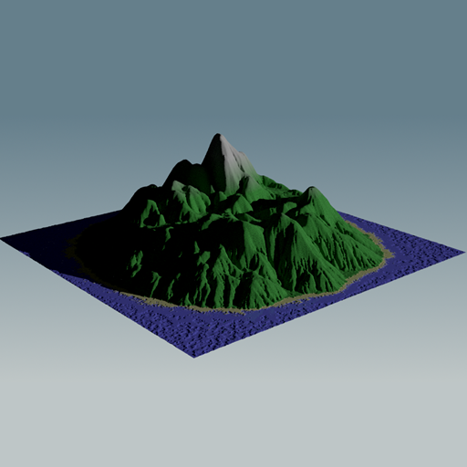
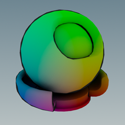
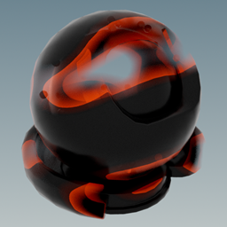
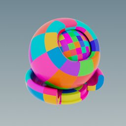
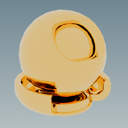
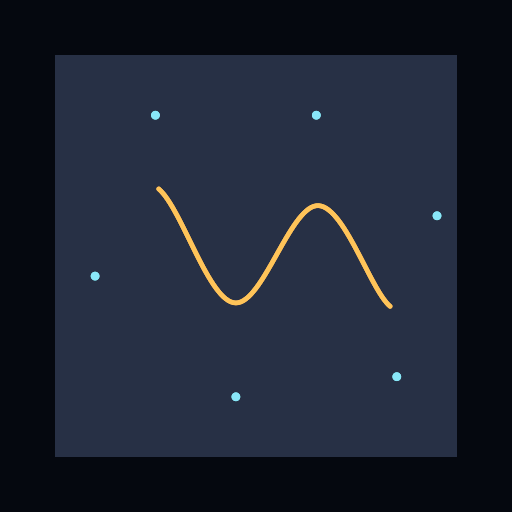

# Examples

## Hello, ShadingLanguageX!

This [tutorial](HelloSLX.md) takes the reader through the development of a basic shader and is meant as an introduction to ShadingLanguageX.

## Other Examples

This folder contains a collection of disjointed examples. They have been written at different times over the years,
they all use valid syntax, but not necessarily the most up to date. 

|            Procedural Rain            |            Interior Mapping             |     Shader Art (by Kishimisu)     |
|:-------------------------------------:|:---------------------------------------:|:---------------------------------:|
|              |     |     |
|         __Procedural Waves__          |        __Displacement Mountain__        |             __Toon__              |
|             |            |          |
|          __Disintegration__           |           __Colored Squares__           |             __Gold__              |
|     |             |          |
|         __B-Spline Curve__            |                                         |                                   |
|           |                                         |                                   |
