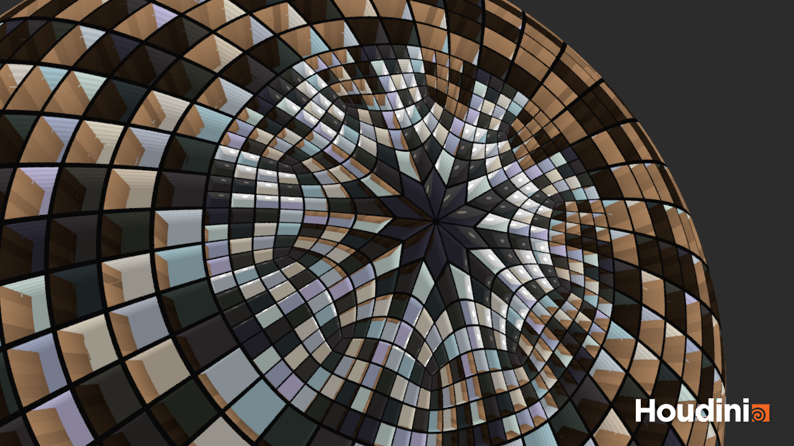
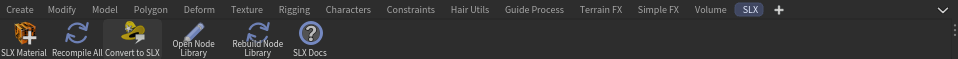
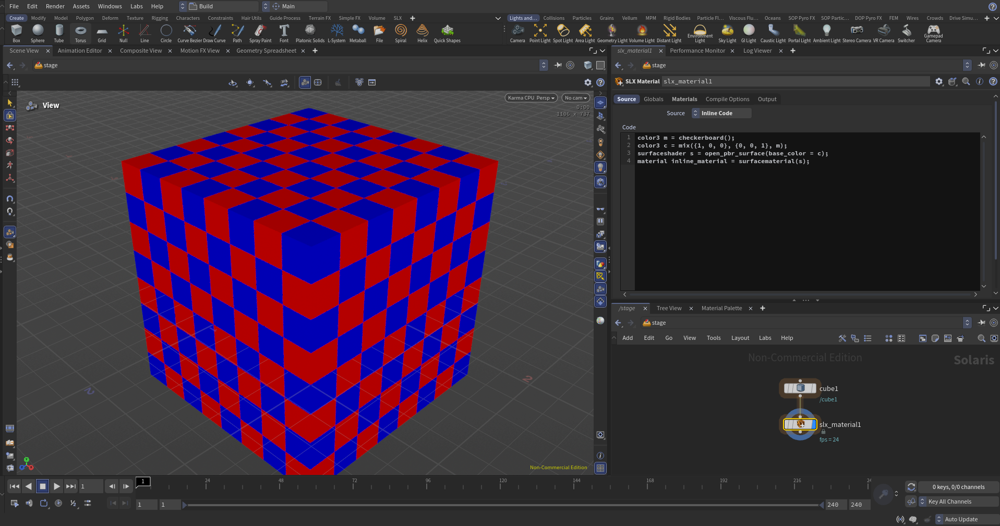
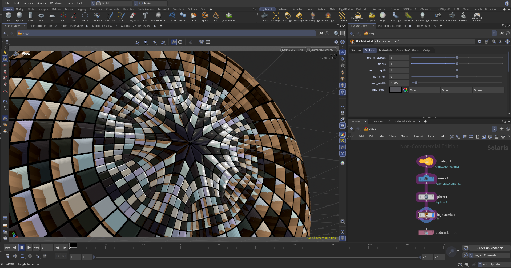
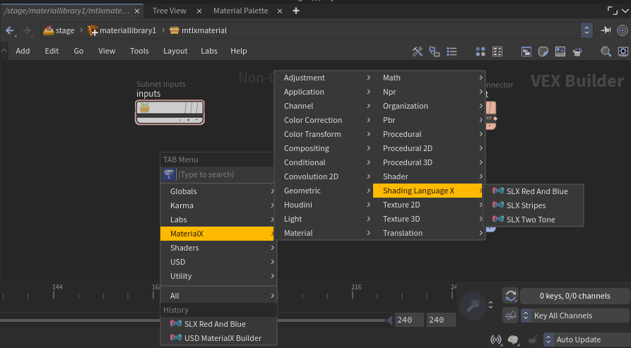
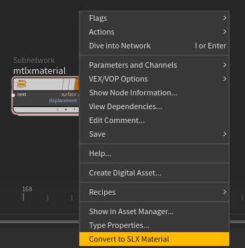

# ShadingLanguageX for Houdini



A Houdini plugin for writing Solaris materials in [ShadingLanguageX](https://github.com/jakethorn/ShadingLanguageX).

- **SLX Material LOP**: compiles an `.mxsl` file, or SLX code typed into the node, into MaterialX materials on the
  USD stage. Each `global` variable in the source becomes a parameter on the node. It recompiles when you save the
  file, can bind its materials to geometry, comes with six examples, and exposes every compile option.
- **Node library**: turns the functions in a folder of SLX files into MaterialX nodes, which Karma and MaterialX
  Material Builders list in their Tab menu.
- **Convert to SLX**: turns a Material Library, a Material Builder, or a referenced `.mtlx` file into an
  SLX Material node holding the equivalent SLX code.
- **SLX shelf**: new SLX Material, Recompile All, Convert to SLX, Open and Rebuild Node Library, and links to the
  docs.



Supported on Houdini 19.5 or later on Windows, Linux and macOS

## Installing

1. Download `ShadingLanguageX-Houdini.zip` from a [release](https://github.com/jakethorn/ShadingLanguageX/releases)
   and unzip it. It holds the compiler for every Houdini version and platform, and the examples.
2. Copy `ShadingLanguageX.json` into the `packages` folder of your Houdini preferences, e.g.
   `~/Documents/houdini22.0/packages`. Then point it at the unzipped `slx` folder by replacing the
   `C:/path/to/...` path in the file.
3. Start Houdini. Add the **SLX** shelf from the shelf's **+** menu.

## The SLX Material LOP



Find it in the LOP Tab menu under **Materials > SLX Material**. Each `material` variable in the SLX source becomes a
material primitive, named after the variable, under the **Material Path Prefix** (`/materials/` by default).

```slx
surfaceshader surface = standard_surface(base_color = color3{1, 0, 0});
material red = surfacematerial(surface);    // -> /materials/red
```

| Tab             | What it does                                                                                                                                                                                                                                                  |
|-----------------|---------------------------------------------------------------------------------------------------------------------------------------------------------------------------------------------------------------------------------------------------------------|
| Source          | Choose **File**, **Inline Code** or **Examples**. **File** loads from an external SLX source file. **Inline Code** provides a code block to write your own SLX shader directly on the node. **Examples** provides a list of pre-made examples to choose from. |
| Globals         | A parameter for each `global` variable in the source, set to its initializer. See below.                                                                                                                                                                      |
| Materials       | **Assignments** bind compiled materials to geometry from the node's input.                                                                                                                                                                                    |
| Compile Options | A list of compile options passed to the SLX compiler, such as MaterialX version, additional search directories, entry function and arguments, macros, and more.                                                                                               |
| Output          | **Cache Directory** where the compiled `.mtlx` files are saved, and buttons to view or export the compiled MaterialX.                                                                                                                                         |

### Globals

```slx
global float roughness = 0.35;          // a slider, defaulting to 0.35
global color3 tint = color3{1, 0.5, 0}; // a color picker
```

The value of `global` variables can be set in the Globals tab, allowing SLX shaders to be parameterized. Like any Houdini
parameter, they can be keyframed or driven by expressions.



### Things to know

- Relative file paths in the source, such as `image("textures/wood.png")`, are relative to the SLX file, or to
  `$HIP` for inline code.
- `#include` and `#library` files that aren't found relative to the file naming them are looked for in each of the
  **Search Directories**, in order. A relative search directory is relative to the SLX file, or to `$HIP` for
  inline code.
- The materials reference compiled `.mtlx` files in the **Cache Directory** (`$HIP/slx_cache` by default). Renders,
  including render farm jobs, must be able to read that directory. Each change writes a new file, named after its
  contents, so USD never shows a stale material. Old files aren't deleted, because USD files you exported earlier
  may still use them.
- Compile errors appear on the node. Houdini wraps them in "Invalid source ...", because the compile runs inside
  the asset.

## Node library

**Open Node Library** on the SLX shelf opens the folder, starting it with an example file. **Rebuild Node Library**
compiles it and makes the nodes, which appear in the Tab menu under **MaterialX > Shading Language X** straight
away.

Every non-inline function in the `.mxsl` files of the node library folder becomes a MaterialX node. Userss can write a
node in code and then use it like any other node in a Karma or MaterialX Material Builder.



```slx
@doc "Repeating ramps from 0 to 1."
float stripes(float x, float count = 8.0)     // the "SLX Stripes" node, with inputs x and count
{
    return fract(x * count);
}
```

- Parameter defaults become the node's defaults, and `@doc` attributes its help. `@nodegroup "procedural2d"` files
  a node under another submenu.
- A templated function, such as `T scale_by<float, vec3>(T x)`, becomes one node with a signature per type. If its
  name has an underscore, Houdini labels the signatures oddly, e.g. "byvector3".
- Inline functions aren't nodes, so use them for helpers.

Things to know:

- **Restart Houdini before rendering new or changed nodes in the viewport.** Karma loads node definitions when it
  starts. Renders to disk and on a farm use them straight away.
- The folder is `$SLX_NODE_LIBRARY`, which defaults to `$HOUDINI_USER_PREF_DIR/slx_nodes`. Houdini only puts it on
  `HOUDINI_PATH` if it exists when Houdini starts, so restart once after creating it.
- Rebuilding writes `materialx/libraries/slx/*.mtlx` (the node definitions), `karmaNodeGraphs.json` (what Karma
  needs to render them, made with Houdini's `mtlx2karma.py`) and `otls/slx_nodes.hda` (the nodes, made with
  Houdini's `mtlx2hda.py`) into the folder.

## Converting materials to SLX

Right-click a Material Library LOP, a material inside one, or a LOP that loads a `.mtlx` file (such as a Reference
LOP), and choose **Convert to SLX Material**. The **Convert to SLX** shelf tool does the same for the selected nodes.
A new SLX Material node appears in the scene with an **Inline Code** block with the decompiled code.


