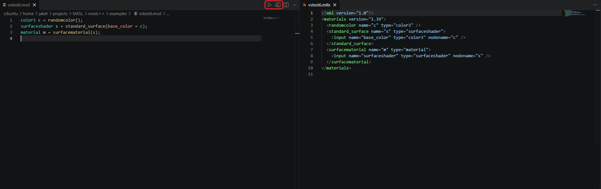
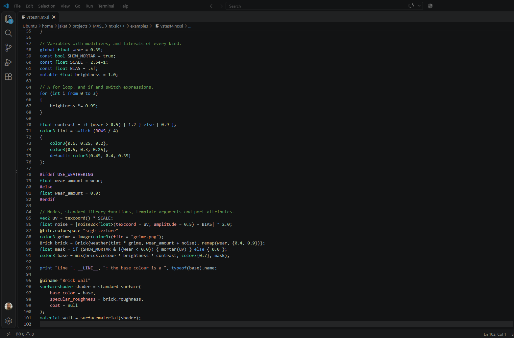
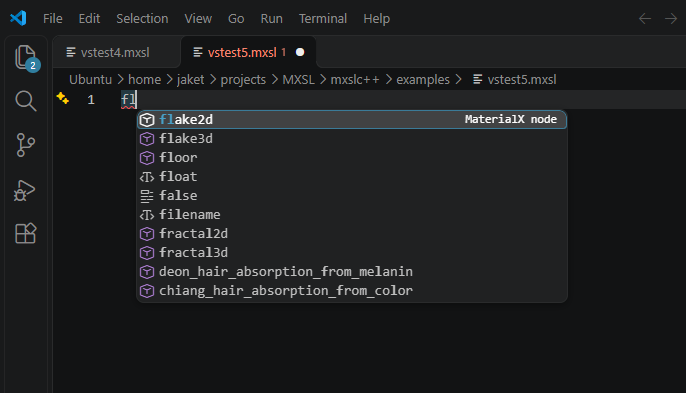
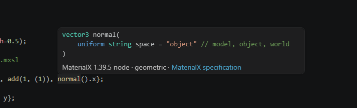
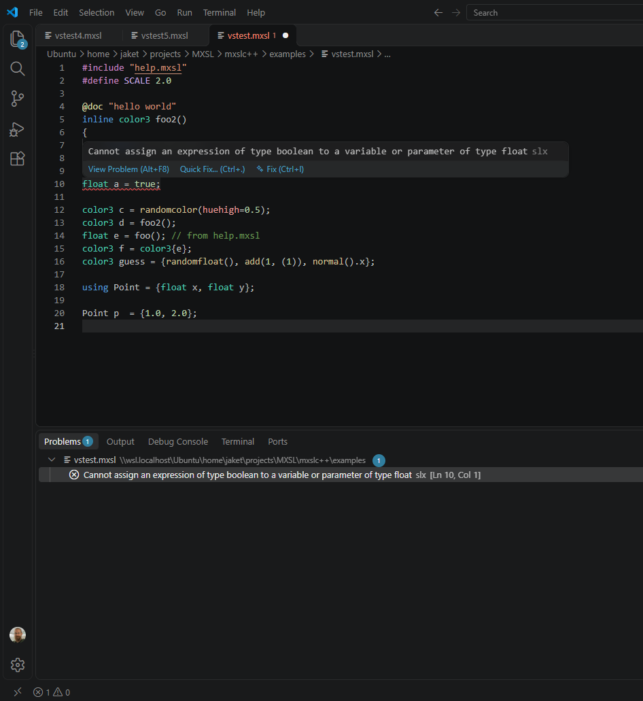

# ShadingLanguageX for VS Code

A VS Code extension that adds language support and commands for [ShadingLanguageX](https://github.com/jakethorn/ShadingLanguageX).

## Installation

Download `slx-<version>.vsix` from the most recent [release](https://github.com/jakethorn/ShadingLanguageX/releases) and install it using VS Code.

## Features

### Compile Tools

The SLX extension adds two buttons to `.mxsl` files. The first compiles the file, giving the user to option to choose
where the `.mtlx` is saved. The second opens a live preview, which shows the compiled MaterialX as you edit the file.  

### Syntax Highlighting

### Code Completion

Press `Ctrl+Space` as you code to list possible types, variables, functions, or directives that match the start of your word.

### Code Navigation

`Ctrl+click` on any type, variable, or function to navigate to its definition, or on an `#include` directive to open 
its file.

### Hover Information

Hover your mouse over any type, variable, or function to see information about it. 
`@doc` attribute strings above user-defined entities will be displayed in the information box.
Standard library functions additionally provide a link to their associated node in the MaterialX documentation.

### Compile Errors

Compile errors are shown as you type, highlighting the line where the error occurs.
The error message can be seen by hovering over the highlighted text, in the `Problems` window in VS Code, or
in the `Output` window after compiling the file.

### Other

* SLX `print` statements print to the console.
* The SLX status bar shows the MaterialX version being used by the compiler. It updates automatically based on the `#version` directive
used in the code.

## AI agents

The extension includes a skill that teaches AI agents about SLX: language features, syntax, standard library, and details about how
the compiler works.

- **GitHub Copilot in VS Code** uses it automatically, in recent versions of VS Code.
- **Claude Code and other agents** read skills from folders. Run *SLX: Install AI Skill* to copy it into your
  personal skills folder (`~/.claude/skills`), for all your projects, or into a workspace's `.claude/skills`, to
  share it through the repository.

A copied skill doesn't update with the extension, and VS Code's chat uses it in place of the one in the extension.
After updating the extension, run *SLX: Install AI Skill* again: it shows which copies are out of date and
replaces them.

## Commands

| Command | What it does |
| --- | --- |
| SLX: Open MaterialX Preview to the Side (Ctrl+K V) | Opens and syncs the compiled MaterialX beside the `.mxsl` file. |
| SLX: Compile to MaterialX | Compiles the `.mxsl` file and saves the MaterialX to a file. Output file is only chosen on first compile. |
| SLX: Compile to MaterialX As... | Compiles the `.mxsl` file and saves the MaterialX to a file. Output file is chosen on every compile. |
| SLX: Decompile to SLX | Decompiles the `.mtlx` file and opens the SLX beside it. |
| SLX: Select MaterialX Version | Sets `slx.materialxVersion`. |
| SLX: Install AI Skill | Copies the SLX skill for AI agents into your personal or a workspace's skills folder. |

## Settings

To access SLX settings press `Ctrl+,`, go to Extensions and then SLX.

| Setting | Default | What it does |
| --- | --- | --- |
| `slx.materialxVersion` | `1.39.5` | MaterialX version to compile against. A `#version` directive in the file takes precedence. |
| `slx.reduceGraph` | `true` | Optimise the compiled node graph. |
| `slx.defaultFunctionBehaviour` | `nodedef` | How functions without a `nodedef`, `nodegraph`, `inline` or `comptime` modifier compile. |
| `slx.errorOnMissingGlobals` | `false` | Report an error if a `global` variable is not passed a value. (Default `false` for now as VS Code has no way to pass global values to the compiler). |
| `slx.includePaths` | `[]` | Extra folders to search for `#include` and `#library` files. Relative paths are resolved against the workspace folder. |
| `slx.links.nodes` | `false` | Turn standard library function calls into links to the associated node's section of the MaterialX specification, opened with Ctrl+Click. |
| `slx.bracketPairColorization` | `false` | Color-code matching brackets by their nesting level. Turning it on or off sets `editor.language.colorizedBracketPairs` for SLX in the same settings file. |
| `slx.diagnostics.trigger` | `onType` | When to check open files for errors: `onType`, `onSave`, or `off`.  |
